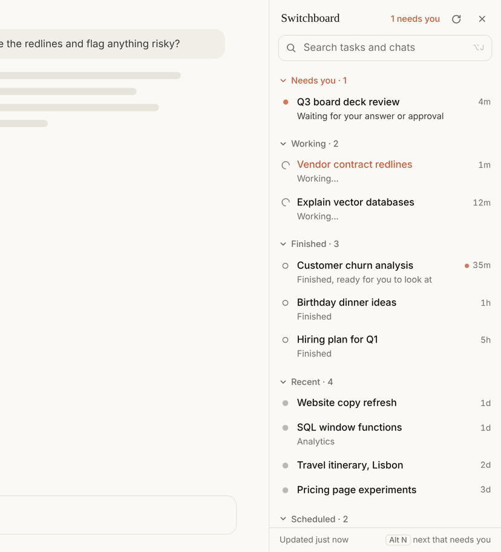

# Claude Switchboard

A Chrome extension that adds a side panel to [claude.ai](https://claude.ai). It lists every
Cowork task and chat by what it needs from you, and switches between them in the same tab.

If you run many Claude tasks in parallel, the ones waiting on you get buried in projects and
long sidebars. Switchboard keeps them in one list, sorted by status.

> Unofficial. Not made, endorsed or supported by Anthropic.

## What it does

- **Sorts by status, not by type.** Cowork tasks and chats share the same sections:
  - **Needs you**: waiting for your answer or approval
  - **Drafts**: you started typing a reply, a new task, or a new task in a project, and didn't send it
  - **Working**: Claude is still going
  - **Finished**: done in the last 24 hours, or ready for you to look at
  - **Waiting for over a week**: still waiting on you, but old (collapsed by default)
  - **Recent**: everything older
  - **Scheduled**: one row per scheduled task, with its run count and new runs
  - **Done**: tasks you marked done (collapsed by default)
- **Switches in place.** Click a row and the chat changes in the same tab, with no reload.
- **Docks as a real side panel.** Claude's page narrows to make room. Close the panel and Claude
  gets its full width back.
- **Done on hover.** Takes a task out of the queue until something new happens in it.
- **Your layout.** Collapse or expand any section, and drag section headers to reorder them.

## Install

Switchboard isn't in the Chrome Web Store. You load it yourself, which takes about a minute.

1. Download `claude-switchboard-<version>.zip` from the
   [latest release](../../releases/latest) and unzip it. Or clone this repo.
2. Open `chrome://extensions` in Chrome (or another Chromium browser: Edge, Brave, Arc).
3. Turn on **Developer mode** (top right).
4. Click **Load unpacked** and pick the `extension` folder.
5. Open [claude.ai](https://claude.ai) and sign in. The panel appears on the right.

### Update

Replace the `extension` folder with the new version (or `git pull`), then press the reload
arrow on the Switchboard card in `chrome://extensions` and reload your claude.ai tab.
Your drafts, done list and layout are kept.

## Use

| Action | How |
| --- | --- |
| Switch to a task or chat | Click its row |
| Search | <kbd>Alt</kbd>+<kbd>J</kbd> (<kbd>Option</kbd>+<kbd>J</kbd> on Mac), type, use the arrow keys, press <kbd>Enter</kbd> |
| Jump to the next one that needs you | <kbd>Alt</kbd>+<kbd>N</kbd> (<kbd>Option</kbd>+<kbd>N</kbd> on Mac) |
| Take something out of the queue | Hover it, click **Done** |
| Put it back | Open the **Done** section, hover it, click **Restore** |
| Collapse or expand a section | Click its header |
| Reorder sections | Drag a header up or down |
| Hide the panel | Click **×**. The **Tasks** button brings it back |

Switchboard works with Claude in the browser. The Claude desktop app doesn't run browser
extensions.

## Privacy

- The extension runs only on `claude.ai` and only reads your own task and chat lists, using
  the sign-in you already have.
- It sends nothing anywhere else. There is no server, analytics or tracking.
- Drafts (the first 80 characters, so you can recognize them), your done list and your section
  layout are stored in Chrome's local extension storage on your computer.
- Permissions: `storage`, plus access to `https://claude.ai/*`.

## Limitations

- Switchboard reads the same task and chat lists the claude.ai web app uses. Those aren't a
  public API, so a Claude update can break the panel. If that happens, the panel shows an
  error and Claude itself keeps working. Please open an issue.
- Drafts are detected in this browser only. A reply you start in the desktop app or on your
  phone doesn't show up as a draft.
- It shows your 100 most recent Cowork tasks and 50 most recent chats.

## Development

There is no build step. `extension/content.js` is plain JavaScript that Chrome loads as is.
Edit it, press reload on the extension card, and reload claude.ai.

## License

[MIT](LICENSE)
